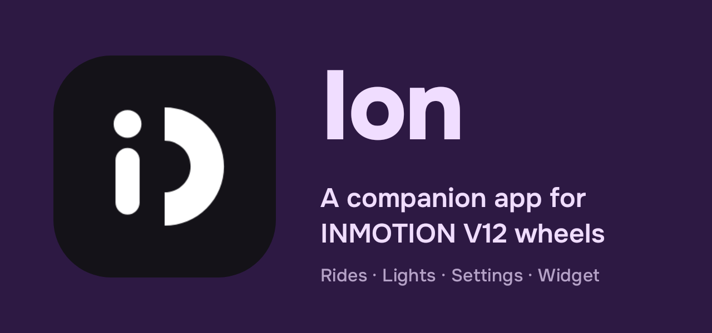
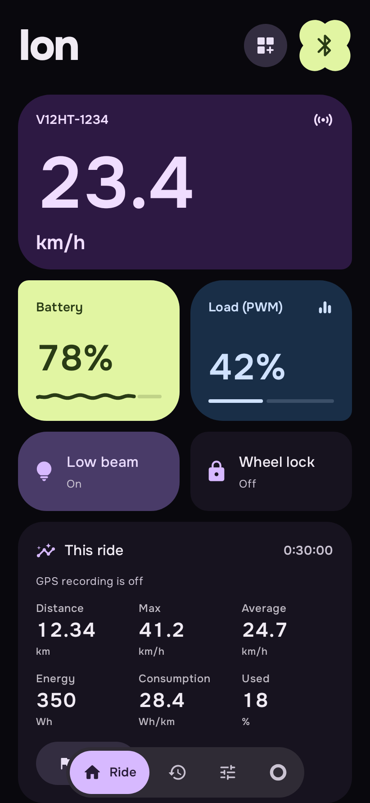
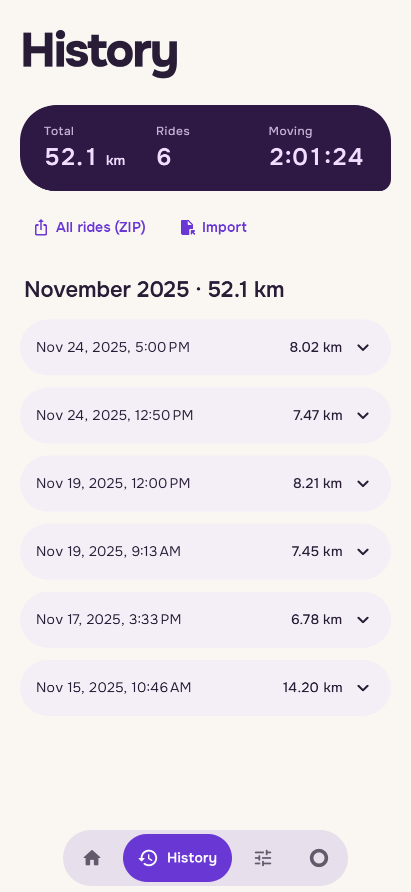
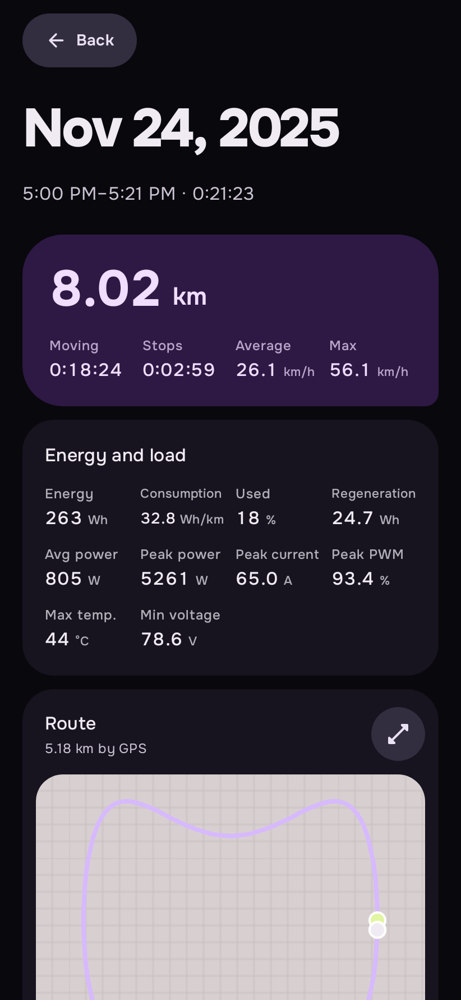
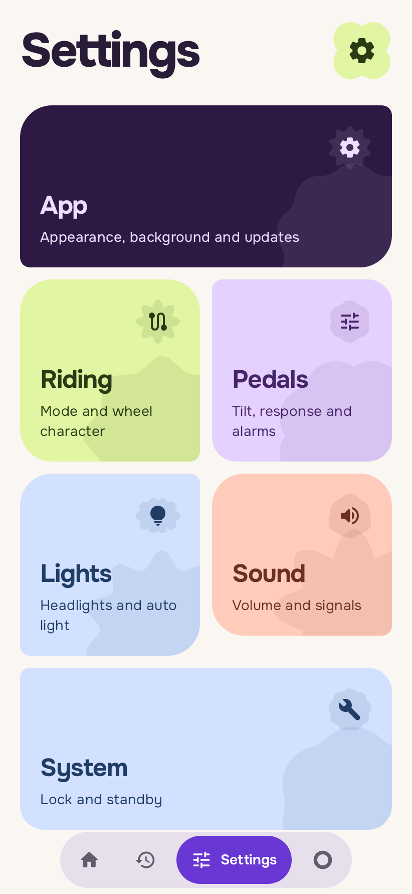
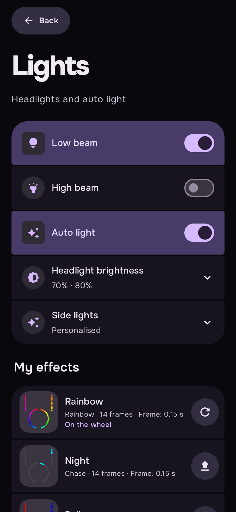
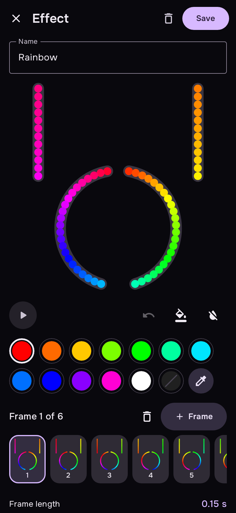

<p align="center"><b>English</b> · <a href="README.ru.md">Русский</a></p>

<p align="center"></p>

<p align="center">
  <a href="https://github.com/0CYBER/ion/releases"></a>
  <a href="https://github.com/0CYBER/ion/actions/workflows/android.yml"></a>
  
  <a href="LICENSE"></a>
</p>

**Ion** is an independent Android app for INMOTION V12 electric unicycles (HT, HS and PRO). It shows the ride live, records every trip with a map and full telemetry, changes the wheel's settings, and lets you paint your own side-light effects LED by LED. It is written in Kotlin with Jetpack Compose and Material 3 Expressive, and works in English and Russian.

> Ion is a hobby project. It is not made, endorsed or supported by INMOTION.

## Screenshots

| Ride | History | Trip |
|:---:|:---:|:---:|
|  |  |  |
| **Settings** | **Lights** | **Light editor** |
|  |  |  |

## Features

**Ride**
- Live speed, battery, PWM load, voltage, current, power, temperatures, trip distance, odometer and remaining range.
- A dashboard you arrange yourself: reorder, hide or repeat tiles.
- Spoken and vibration alerts. Danger alerts (critical battery, overheating, wheel errors, speed) interrupt anything else being said.

**Trips**
- Every ride is recorded on its own, with optional GPS.
- History grouped by month, with lifetime totals.
- Each trip has a summary of distance, pace, energy and load, plus a ride explorer. The explorer shows the map (full screen if you like), a chart of speed, power, battery and PWM, and every reading at the point you pick.
- Export a ride as CSV (all telemetry) or GPX (the route). "All rides (ZIP)" exports everything at once and doubles as a backup that "Import" restores.

**Wheel settings**
- Headlights, brightness and auto light.
- Volume and sound previews.
- Ride modes, maximum speed, pedal tilt and sensitivity, Split Mode and alarm thresholds.
- Handle button, transport mode, wheel lock and standby timer.

**Side lights**
- The modes (off, music, speed or personalised), switched from the app.
- A full-screen editor with the 70 LEDs drawn where they sit on the wheel. Paint by tapping or dragging, build up to 60 frames, preview them and set the frame length.
- Templates to start from: solid, blink, breathe, gradient, chase, rainbow and halves.
- Ion uploads effects to the wheel, turns on any effect stored there and cleans up unfinished uploads.

**Everyday**
- On Android 12+, the wheel is linked as a companion device, so the connection survives in the background. Reconnects automatically (3 attempts by default, up to unlimited).
- Home-screen widget and a Quick Settings tile.
- Light, dark or system theme.
- Updates from GitHub releases inside the app.

## Supported wheels

INMOTION V12 HT, HS and PRO (series 7, variants 1–3) over Bluetooth LE. All three use the same protocol. So far Ion has been tested on real hardware with a V12 HT only.

## Install

Download the latest APK from [Releases](https://github.com/0CYBER/ion/releases) and install it. Every push to `main` publishes a signed prerelease. Ion then finds newer builds by itself.

Requires Android 8.0 (API 26) or newer, with Bluetooth LE.

## Safety

Changing settings on a moving wheel is dangerous, so Ion is deliberately careful:

- **Two tiers.** Lights and sound need a live, verified link. Ride modes, pedals and service settings also need fresh telemetry showing that the wheel is standing still. Both are rechecked right before anything is sent.
- **Read-back.** A change counts as done only when a fresh read-back from the wheel confirms it. Failures are shown and never retried automatically.
- **Controls.** Switches apply at once. Sliders sit in expandable rows and are sent with Apply.

This is not a certified safety interlock. Stop the wheel before changing ride settings.

## Build from source

You need JDK 21 and Android SDK 37 (AGP 9.3.1, Gradle 9.7.1). The minimum API is 26 and the target is 35.

```powershell
.\gradlew.bat testDebugUnitTest lintDebug assembleDebug
```

The debug APK lands in `app/build/outputs/apk/debug/app-debug.apk`.

<details>
<summary>Signed release, startup check and README images</summary>

**Signed release.** Put the Ion PKCS#12 keystore on the build machine and create an ignored `keystore.properties` in the repository root. It needs `storeFile` (the keystore path, with forward slashes on Windows) and `storePassword`. The key alias is `ion-release`, and the key password is the same as the store password.

```powershell
.\gradlew.bat --no-configuration-cache :app:assembleRelease
```

GitHub Actions uses the same keystore through the `ION_RELEASE_KEYSTORE_BASE64` and `ION_RELEASE_STORE_PASSWORD` secrets. Pull requests build an unsigned APK.

**Startup check.** Before handing out an optimised APK, launch the packaged release on an emulator. Unit tests do not catch R8 startup failures.

```powershell
.\tools\Test-ApkStartup.ps1 -Apk app/build/outputs/apk/release/app-release.apk -Serial emulator-5580
```

**README images.** The banner and screenshots are rendered by Robolectric tests straight into `docs/readme/`:

```powershell
.\gradlew.bat :app:testDebugUnitTest -PreadmeShots --tests "com.freecyber.ion.ReadmeShots*"
```

</details>

## Project layout

| Path | What is inside |
|---|---|
| `core/` | Pure Kotlin: the V12 protocol, trip recording, light-effect files. Tested on the JVM. |
| `app/` | The Android app: Bluetooth, the UI, the widget and the background service. |
| `docs/design-system.md` | Ion's Material 3 Expressive design rules. |
| `handoff.md` | Current state: verified protocols (lock, sounds, lights), modules, build and CI. |
| `docs/rolling-handoff.md` | The full running work log. |

## Thanks

Ion stands on the work of others:

- [**WheelLog**](https://github.com/Wheellog/Wheellog.Android): the V12 protocol, field layouts and test packets come from its INMOTION adapter.
- [**osmdroid**](https://github.com/osmdroid/osmdroid) draws the trip maps, and the map data comes from [**OpenStreetMap**](https://www.openstreetmap.org/copyright) contributors.
- [**Onest**](https://github.com/google/fonts/tree/main/ofl/onest) and [**JetBrains Mono**](https://github.com/JetBrains/JetBrainsMono) are the fonts.
- Google's [**Jetpack Compose**](https://developer.android.com/compose), [**Material 3**](https://m3.material.io/), [**Glance**](https://developer.android.com/develop/ui/compose/glance) and the rest of AndroidX, plus JetBrains' [**Kotlin**](https://kotlinlang.org/) and [**kotlinx.coroutines**](https://github.com/Kotlin/kotlinx.coroutines).
- [**Robolectric**](https://robolectric.org/), [**Roborazzi**](https://github.com/takahirom/roborazzi) and [**JUnit**](https://junit.org/junit4/) run the tests and render the screenshots above.

## License

Ion is released under the [GNU General Public License v3.0](LICENSE).

Third-party components keep their own licenses. Details are in [THIRD_PARTY.md](THIRD_PARTY.md), and license texts in [`third-party/`](third-party).

| Component | License |
|---|---|
| WheelLog (protocol reference, test fixtures) | GPL-3.0 |
| osmdroid | Apache-2.0 |
| OpenStreetMap data | ODbL 1.0 |
| Onest, JetBrains Mono | SIL OFL 1.1 |
| AndroidX, Jetpack Compose, Material 3, Glance | Apache-2.0 |
| Kotlin, kotlinx.coroutines | Apache-2.0 |
| Robolectric (tests) | MIT |
| Roborazzi (tests) | Apache-2.0 |
| JUnit 4 (tests) | EPL-1.0 |

INMOTION and V12 are trademarks of their owner and are used here only to name the supported wheels.
