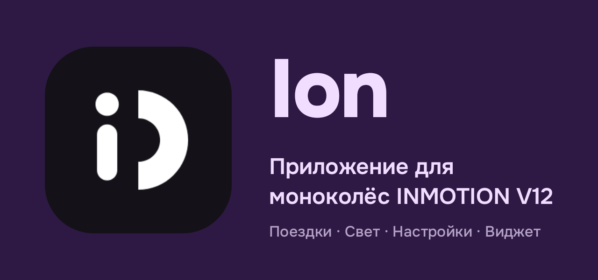
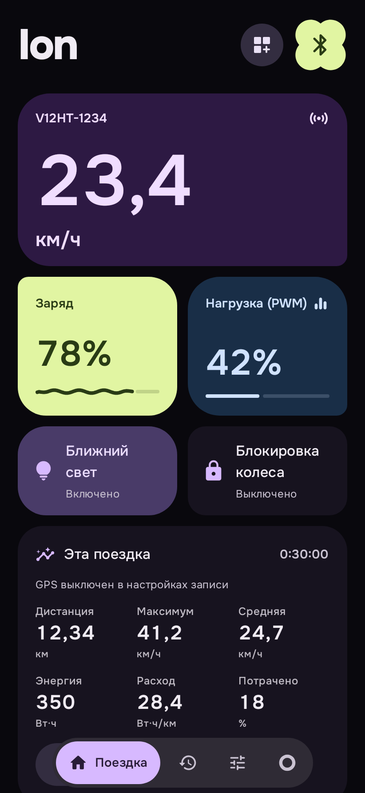
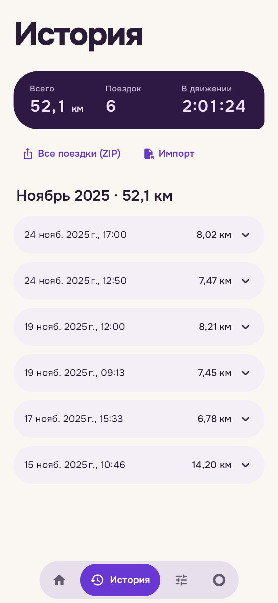
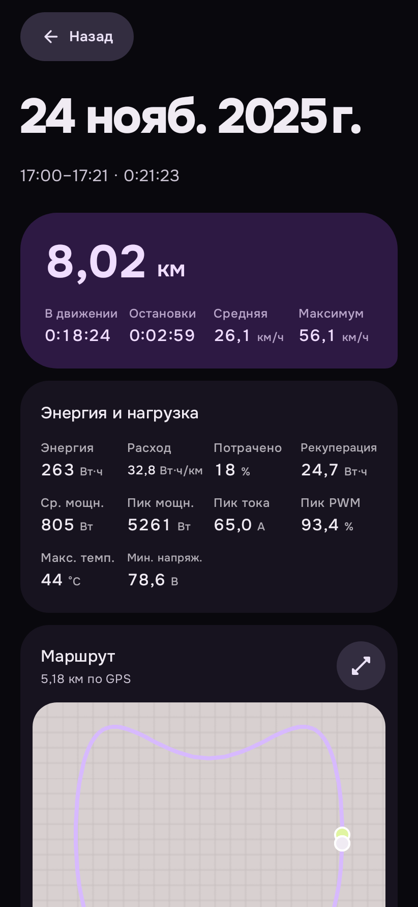
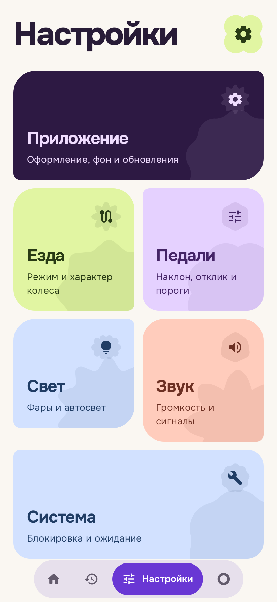
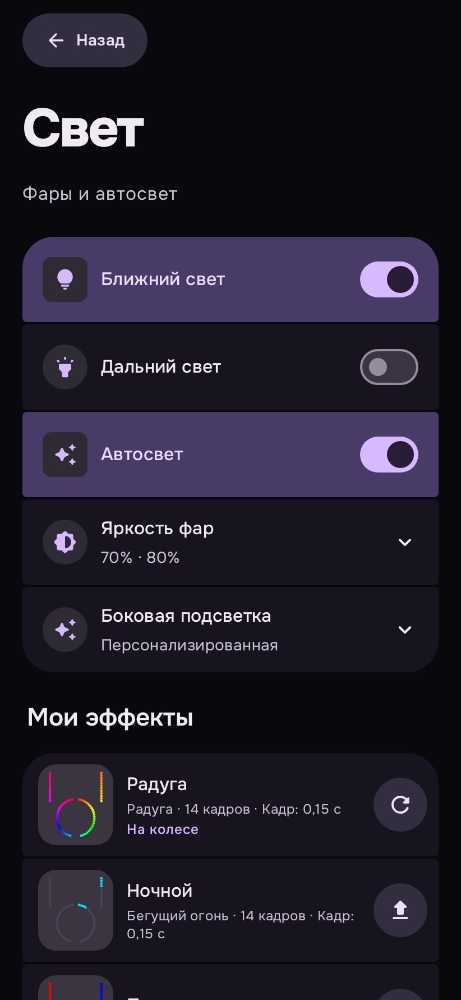
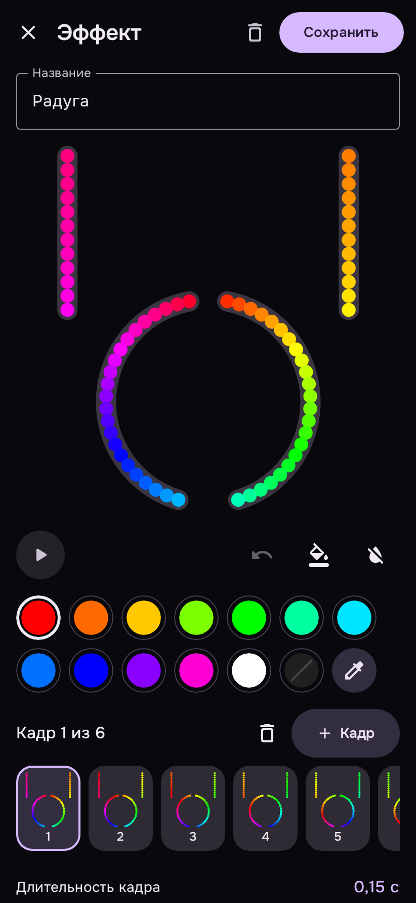

<p align="center"><a href="README.md">English</a> · <b>Русский</b></p>

<p align="center"></p>

<p align="center">
  <a href="https://github.com/0CYBER/ion/releases"></a>
  <a href="https://github.com/0CYBER/ion/actions/workflows/android.yml"></a>
  
  <a href="LICENSE"></a>
</p>

**Ion** — независимое Android-приложение для моноколёс INMOTION V12 (HT, HS и PRO). Оно показывает поездку в реальном времени, записывает каждую поездку с картой и полной телеметрией, меняет настройки колеса и позволяет рисовать свои эффекты боковой подсветки по светодиодам. Написано на Kotlin с Jetpack Compose и Material 3 Expressive, интерфейс на русском и английском.

> Ion — хобби-проект. INMOTION его не делает, не одобряет и не поддерживает.

## Скриншоты

| Поездка | История | Детали поездки |
|:---:|:---:|:---:|
|  |  |  |
| **Настройки** | **Свет** | **Редактор подсветки** |
|  |  |  |

## Возможности

**Поездка**
- Скорость, заряд, нагрузка (PWM), напряжение, ток, мощность, температуры, пробег за поездку, одометр и остаток хода в реальном времени.
- Экран поездки собирается под себя: плитки можно переставлять, скрывать и повторять.
- Голосовые и вибро-оповещения. Опасные (критический заряд, перегрев, ошибка колеса, скорость) перебивают всё остальное.

**Поездки**
- Каждая поездка записывается сама, GPS по желанию.
- История по месяцам, с общими итогами.
- У каждой поездки есть сводка: дистанция, темп, энергия и нагрузка, а ещё исследователь поездки. В нём карта (её можно развернуть на весь экран), график скорости, мощности, заряда и PWM и все показания в выбранной точке.
- Экспорт поездки в CSV (вся телеметрия) или GPX (маршрут). «Все поездки (ZIP)» выгружает всё сразу. Этот же архив служит резервной копией, «Импорт» его восстанавливает.

**Настройки колеса**
- Фары, яркость и автосвет.
- Громкость и прослушивание звуков.
- Режимы езды, максимальная скорость, наклон и чувствительность педалей, Split Mode и пороги сигналов.
- Кнопка ручки, транспортный режим, блокировка колеса и таймер ожидания.

**Боковая подсветка**
- Режимы (выключена, музыка, скорость или персонализированная) переключаются из приложения.
- Полноэкранный редактор: 70 светодиодов нарисованы там, где они стоят на колесе. Красить касанием или проведением пальца, до 60 кадров, проигрывание и длительность кадра.
- Шаблоны для старта: один цвет, мигание, дыхание, градиент, бегущий огонь, радуга, половинки.
- Ion загружает эффекты на колесо, включает любой сохранённый там эффект и убирает недописанные загрузки.

**Каждый день**
- На Android 12+ колесо привязывается как сопутствующее устройство, поэтому связь держится в фоне. Автопереподключение (по умолчанию 3 попытки, можно без ограничений).
- Виджет на главный экран и плитка в быстрых настройках.
- Material You: цвета из обоев на Android 12+ или одна из шести палитр; светлая, тёмная или системная тема.
- Обновления из релизов GitHub прямо в приложении.

## Поддерживаемые колёса

INMOTION V12 HT, HS и PRO (серия 7, варианты 1–3) по Bluetooth LE. Протокол у всех трёх одинаковый. На живом колесе Ion пока проверен только с V12 HT.

## Установка

Скачай последний APK из [Releases](https://github.com/0CYBER/ion/releases) и установи. Каждый пуш в `main` публикует подписанный пререлиз. Дальше Ion сам находит новые сборки.

Нужен Android 8.0 (API 26) или новее с Bluetooth LE.

## Безопасность

Менять настройки едущего колеса опасно, поэтому Ion осторожничает:

- **Два уровня.** Свету и звуку нужна живая проверенная связь. Режимам езды, педалям и сервисным настройкам нужна ещё и свежая телеметрия, по которой видно, что колесо стоит. Оба условия перепроверяются прямо перед отправкой.
- **Проверка ответом колеса.** Изменение засчитывается, только когда свежее чтение с колеса его подтверждает. Ошибки показываются и сами не повторяются.
- **Управление.** Переключатели применяются сразу. Ползунки спрятаны в раскрывающиеся строки и отправляются кнопкой «Применить».

Это не сертифицированная защита. Останавливайте колесо, прежде чем менять настройки езды.

## Сборка из исходников

Нужны JDK 21 и Android SDK 37 (AGP 9.3.1, Gradle 9.7.1). Минимальный API 26, целевой 35.

```powershell
.\gradlew.bat testDebugUnitTest lintDebug assembleDebug
```

Отладочный APK появится в `app/build/outputs/apk/debug/app-debug.apk`.

<details>
<summary>Подписанный релиз, проверка запуска и картинки для README</summary>

**Подписанный релиз.** Положи keystore Ion (PKCS#12) на машину сборки и создай в корне репозитория `keystore.properties`, он в `.gitignore`. В нём нужны `storeFile` (путь к keystore, на Windows через прямые слэши) и `storePassword`. Алиас ключа `ion-release`, пароль ключа совпадает с паролем хранилища.

```powershell
.\gradlew.bat --no-configuration-cache :app:assembleRelease
```

GitHub Actions берёт тот же keystore из секретов `ION_RELEASE_KEYSTORE_BASE64` и `ION_RELEASE_STORE_PASSWORD`. Pull request собирает APK без подписи.

**Проверка запуска.** Прежде чем раздавать оптимизированный APK, запусти собранный релиз на эмуляторе. Юнит-тесты не ловят падения R8 при старте.

```powershell
.\tools\Test-ApkStartup.ps1 -Apk app/build/outputs/apk/release/app-release.apk -Serial emulator-5580
```

**Картинки для README.** Баннер и скриншоты рисуются тестами Robolectric прямо в `docs/readme/`:

```powershell
.\gradlew.bat :app:testDebugUnitTest -PreadmeShots --tests "com.freecyber.ion.ReadmeShots*"
```

</details>

## Устройство проекта

| Путь | Что внутри |
|---|---|
| `core/` | Чистый Kotlin: протокол V12, запись поездок, файлы эффектов подсветки. Тестируется на JVM. |
| `app/` | Android-приложение: Bluetooth, интерфейс, виджет и фоновый сервис. |
| `docs/design-system.md` | Правила дизайна Ion на Material 3 Expressive. |
| `handoff.md` | Текущее состояние: проверенные протоколы (блокировка, звуки, подсветка), модули, сборка и CI. |
| `docs/rolling-handoff.md` | Полный рабочий журнал. |

## Спасибо

Ion держится на чужой работе:

- [**WheelLog**](https://github.com/Wheellog/Wheellog.Android): протокол V12, раскладка полей и тестовые пакеты взяты из его адаптера INMOTION.
- [**osmdroid**](https://github.com/osmdroid/osmdroid) рисует карты поездок, а данные карт дают участники [**OpenStreetMap**](https://www.openstreetmap.org/copyright).
- [**Onest**](https://github.com/google/fonts/tree/main/ofl/onest) и [**JetBrains Mono**](https://github.com/JetBrains/JetBrainsMono) — шрифты.
- Google: [**Jetpack Compose**](https://developer.android.com/compose), [**Material 3**](https://m3.material.io/), [**Glance**](https://developer.android.com/develop/ui/compose/glance) и остальной AndroidX. JetBrains: [**Kotlin**](https://kotlinlang.org/) и [**kotlinx.coroutines**](https://github.com/Kotlin/kotlinx.coroutines).
- [**Robolectric**](https://robolectric.org/), [**Roborazzi**](https://github.com/takahirom/roborazzi) и [**JUnit**](https://junit.org/junit4/) гоняют тесты и рисуют скриншоты выше.

## Лицензия

Ion распространяется по [GNU General Public License v3.0](LICENSE).

Сторонние компоненты остаются под своими лицензиями. Подробности в [THIRD_PARTY.md](THIRD_PARTY.md), тексты лицензий в [`third-party/`](third-party).

| Компонент | Лицензия |
|---|---|
| WheelLog (протокол, тестовые пакеты) | GPL-3.0 |
| osmdroid | Apache-2.0 |
| Данные OpenStreetMap | ODbL 1.0 |
| Onest, JetBrains Mono | SIL OFL 1.1 |
| AndroidX, Jetpack Compose, Material 3, Glance | Apache-2.0 |
| MaterialKolor (схемы Material You из seed-цвета) | MIT |
| Kotlin, kotlinx.coroutines | Apache-2.0 |
| Robolectric (тесты) | MIT |
| Roborazzi (тесты) | Apache-2.0 |
| JUnit 4 (тесты) | EPL-1.0 |

INMOTION и V12 — товарные знаки их владельца. Здесь они нужны только чтобы назвать поддерживаемые колёса.
